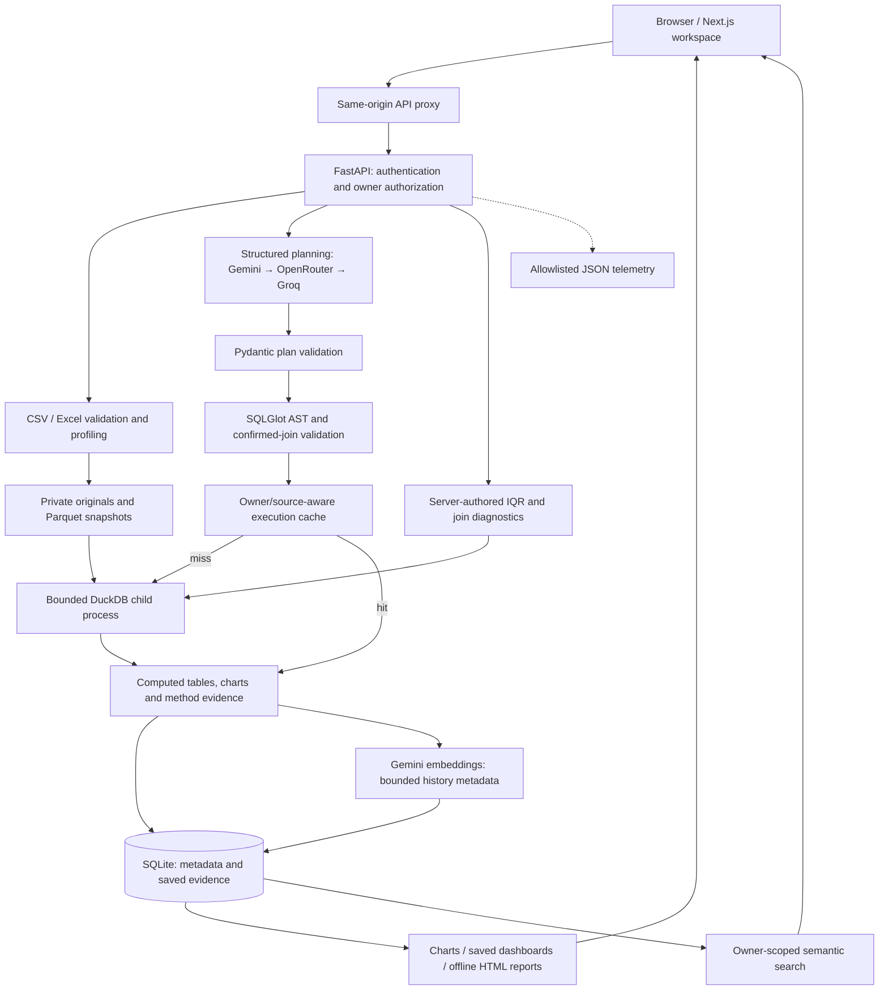

# Digital Back Office AI Data Analyst

**Natural-language questions → validated SQL → computed answers, interactive charts, and reusable evidence.**


Built for the **Digital Back Office Ltd. AI Engineer Assignment**, this application turns uploaded business files into inspectable analysis. Every completed query carries computed values, SQL, a method summary, and source versions. Saved evidence powers dashboards and offline reports; the LLM proposes operations while the application controls execution.

[Demo video](#demo-and-preview) · [Screenshots](#screenshots) · [Architecture](#architecture) · [Setup](#getting-started) · [Verification](#testing-and-verification)

## Demo and preview

**Demo video: pending capture.** The required 10–30 second recording has not been added. Place the real recording at `docs/assets/demo/walkthrough.mp4`, then replace this notice with a repository-relative link.

Suggested sequence: profile, chart/SQL, follow-up, dashboard, report. Prepare model-dependent results before recording.

### Screenshots

No screenshots are currently included. Capture actual application output using the synthetic fixtures; the login page's decorative revenue preview is not computed evidence.

| Preview to capture | Intended asset path |
| --- | --- |
| Main workspace: datasets and profile | `docs/assets/screenshots/datasets.png` |
| Analysis: chart, table, method and SQL | `docs/assets/screenshots/analysis.png` |
| Configurable relationships and diagnostics | `docs/assets/screenshots/joins.png` |
| Saved dashboard | `docs/assets/screenshots/dashboard.png` |
| Offline report, optional | `docs/assets/screenshots/report.png` |

<!-- TODO: After capturing real assets, replace this table with relative Markdown images or a GitHub HTML gallery. Do not link nonexistent files. -->

## The problem

Business questions span fragmented CSVs, require SQL expertise, and produce AI answers that are hard to verify. This workspace connects plain-language questions to inspectable calculations and reusable dashboards/reports.

## Key features

| Area | Implemented capabilities |
| --- | --- |
| Data preparation | CSV/XLS/XLSX ingestion, per-file validation, type inference, missing/duplicate counts, 50-row previews, immutable snapshots |
| Analytics | Structured planning, validated SQL, bar/line/pie/scatter charts, bounded conversational context, deterministic IQR anomalies |
| Multi-file analysis | Up to five selected sources, explicit relationships, unmatched-row/cardinality diagnostics, version-bound confirmation |
| Workflows | Persistent conversations, saved dashboards, semantic history search, reusable evidence, self-contained HTML reports |
| Engineering | Local authentication, owner authorization, bounded query processes, provider fallback, execution caching, safe telemetry and automated tests |

Answers expose **Chart / Table**, **Method**, **SQL**, and source versions. Post-query wording is deterministic and basic; rich AI-generated business recommendations are not implemented.

## Architecture



SQLite stores metadata, sessions, conversations, evidence, dashboards and embeddings. DuckDB children load authorized Parquet snapshots into memory. Dashboards reuse the analytical pipeline; reopening/exporting reads persisted evidence.

Older [architecture notes](docs/architecture/README.md) contain superseded limits; this README follows current source.

## How an analysis works

For **“Show total revenue_usd by region as a bar chart”**:

1. The user selects a source and submits the question.
2. FastAPI authorizes it and constructs bounded schema/context: no full CSV or raw result table is sent for planning.
3. A provider returns a structured plan; Pydantic validates its fields.
4. SQLGlot checks the SQL AST against permitted operations, registered columns and confirmed relationships.
5. An eligible cache hit is reused; otherwise DuckDB executes the approved query in a child process.
6. The backend constructs answer text, chart values and method evidence from actual results.
7. Evidence is saved and displayed with SQL and source versions. Semantic indexing is attempted separately from analytical correctness.

The LLM cannot directly execute Python, shell commands or arbitrary tools. Valid SQL can still express the wrong business interpretation: inspect the calculation and assumptions.

## Multi-dataset analysis and configurable joins

Select two to five datasets in **Analyze → Configure cross-file joins**. Choose both endpoints, their columns, and **Inner** or **Left** for each relationship:

```text
sales.customer_id → customers.customer_id
sales.product_id  → products.product_id
```

The root need not be the first selected dataset. Relationships may be entered in any order; the server orders a connected directed tree without reversing LEFT semantics. There must be exactly one fewer relationships than sources, one root, and one parent per non-root source. Keys must have matching types, except integer/decimal compatibility.

Click **Review join diagnostics**, inspect duplicate/null keys, unmatched rows, cardinality and expected pair rows, acknowledge multiplication when required, then **Confirm these keys and join types**. Edits clear consent. SQL must match the exact confirmed source/key/type graph; a chat message saying “yes” grants no permission.

No composite keys, cycles, self/cross/full/right joins, parallel paths or nested joined queries are supported. Diagnostics are pairwise, not final multi-hop estimates. Fanout warnings and consent **do not correct double counting**; no automatic pre-aggregation rewrite exists.

## Technology stack

Declared versions: [frontend](frontend/package.json), [backend](backend/pyproject.toml). Lockfiles pin installations.

| Layer | Dependencies |
| --- | --- |
| Frontend | Next.js 16.4.0, React 19.3.0, TypeScript ^5.9.3, Tailwind CSS 4.3.3, Plotly basic ^4.1.2 |
| API | Python 3.13, FastAPI >=0.115,<1, Pydantic >=2.10,<3, Uvicorn |
| AI | Google GenAI SDK >=1,<2; HTTPX provider adapters; structured JSON; Gemini embeddings |
| Analytics | DuckDB >=1.3,<2, SQLGlot >=27,<30, PyArrow >=20,<24; openpyxl/xlrd |
| Persistence | SQLite, SQLAlchemy >=2,<3, Alembic >=1.14,<2 |
| Delivery/checks | Docker Compose, GitHub Actions, uv, pytest, Ruff, ESLint, TypeScript |

## Getting started

Prerequisites: **Python 3.13**, **uv**, **Node.js 24** and npm. Commands use PowerShell; on Unix replace `Copy-Item` with `cp` and `npm.cmd` with `npm`. Run each terminal from the cloned root.

```powershell
git clone https://github.com/HChandramania/AI-Data-Analyst.git
cd AI-Data-Analyst
```

This is the configured Git remote; public availability has not been verified.

**Terminal 1 — backend:**

```powershell
cd backend
Copy-Item .env.example .env
# Edit backend/.env: configure a planning provider key before asking questions.
uv sync --frozen
uv run --frozen alembic upgrade head
uv run --frozen python -m app.serve
```

**Terminal 2 — frontend:**

```powershell
cd frontend
Copy-Item .env.example .env.local
npm.cmd ci
npm.cmd run dev
```

Do not overwrite existing configuration. Open [localhost:3000/register](http://localhost:3000/register), create an account, and choose **Try the analysis sample** in Datasets (**Load analysis sample** in a nonempty library). In **Analyze**, select `analysis_flat.csv` and submit the first prompt below. No account is seeded.

### Configuration

Use [backend/.env.example](backend/.env.example) locally; Docker uses the [root example](.env.example). Provider secrets stay server-side, never in frontend variables.

| Variable | Requirement/default |
| --- | --- |
| `DBO_GEMINI_API_KEY` | Enables Gemini planning and semantic embeddings |
| `DBO_OPENROUTER_API_KEY`, `DBO_GROQ_API_KEY` | Optional planning alternatives/fallbacks; at least one planning key required for new questions |
| `DBO_GEMINI_MODEL` | Default `gemini-3.8-flash` |
| `DBO_OPENROUTER_MODEL`, `DBO_GROQ_MODEL` | Defaults `openai/gpt-4o-mini`, `openai/gpt-oss-120b` |
| `DBO_PROVIDER_TIMEOUT_SECONDS` | Default 30; range 1–60, shared planning budget |
| `DBO_QUERY_TIMEOUT_SECONDS` | Default 5; range 1–30 per execution |
| `DBO_PUBLIC_ORIGIN` | Must match browser origin; example `http://localhost:3000` |
| `DBO_ALLOW_INSECURE_COOKIES` | Example enables local HTTP; disable for HTTPS |
| `DBO_DATA_DIR` | Local example `./data`, relative to backend working directory |
| `BACKEND_URL` | Frontend server-only proxy target; local example `http://127.0.0.1:8000` |

Planning tries Gemini → OpenRouter → Groq, skipping blank keys, with at most one application-level attempt per provider within the shared deadline. Failures/malformed plans may advance; valid clarification stops routing, and rejected SQL does not trigger fallback. Model access depends on the provider account. Embeddings remain Gemini-only.

Provider keys/models and timeouts reload from the runtime file; storage/origin/cookie changes require restart. Fallback sends bounded context to additional providers and can incur charges. Missing keys return errors, never fake answers.

## Docker setup

Requires Docker Engine/Desktop with Compose v2. From the repository root:

```powershell
Copy-Item .env.example .env
# Edit .env with provider configuration; the file must exist for the mount.
docker compose up --build -d --wait
docker compose ps
# Stop services while retaining stored data:
docker compose down
```

Open `http://localhost:3000/register`. Loopback ports default to **3000/8000**; override `FRONTEND_PORT`/`BACKEND_PORT` and align `DBO_PUBLIC_ORIGIN`. Migrations precede backend startup; frontend waits for backend health. Containers run non-root.

The `backend_data` volume persists sessions, metadata and files. **`docker compose down --volumes` deletes them.** Root `.env` is mounted read-only. Recreate for startup-setting changes; rebuild for code changes.

Earlier isolated Docker checks are recorded, but the current clean-start/restart gate remains open: Docker Engine was unavailable during the October 15 audit. Local HTTP cookie settings are not a public deployment configuration.

## Example walkthrough

The [synthetic fixture](sample_data/analysis_flat.csv) contains 24 January-March 2026 sales. Revenue = quantity * unit price, excluding taxes/refunds/shipping. The [oracle](sample_data/expected_answers.json) and [verifier](sample_data/verify.py) establish expected values, not benchmarks or guaranteed model output.

| Step | Exact prompt | Expected fixture result |
| --- | --- | --- |
| Regional chart | Show total revenue_usd by region, ordered from highest to lowest, as a bar chart. | South $1,800; North $960; West $520; East $480. Total $3,760. |
| Contextual trend | Now show that revenue by calendar month using sale_date, across all regions, as a line chart. | January $360; February $1,000; March $2,400. |
| Anomaly investigation | Detect outliers in revenue_usd using the 1.5 × IQR rule across the entire dataset, without grouping. | One $1,000 sale flagged; Q1 $67.50, Q3 $182.50, bounds −$105/$355. |

Keep the selection for follow-ups; changes start a new conversation. Reopen **Previous conversations**; inspect **Method**, **SQL**, and **Chart / Table**.

**Dashboard:** click **Generate dashboard**, name it, and request total revenue, regional revenue and a monthly trend. Up to six cards are computed sequentially within a 90-second generation budget. Partial results are saved. Alternatively select **Reuse** analyses and disable **Generate additional cards**. Reopen from **Dashboards** without recomputation; cards are not editable.

**Report:** choose **Export report**, select completed analyses/cards, and **Download HTML**. Reports embed charts/runtime, tables, SQL, methods and sources, support offline theme switching, and are capped at 12 expanded analyses/8 MiB. Select successful cards individually from partial dashboards. Reports are generated in memory; downloaded copies cannot be revoked.

**History search:** **Search past analyses → Search by meaning** retrieves saved evidence; **Index older analyses** handles up to 20 missing records. Gemini produces normalized 768-dimensional vectors stored in SQLite. Search considers up to 500 recent candidates, returns up to ten, and applies a heuristic 0.60 similarity floor. Relevant paraphrases can be missed; live relevance acceptance remains open.

## Security and reliability

| Boundary | Enforcement |
| --- | --- |
| Uploads | 10 files/request; 64 MiB/file; 256 MiB/request; 1,100,000 rows and 50 columns/file; XLSX declared expansion capped at 64 MiB |
| SQL/results | One allowlisted statement, authorized sources, 12,000-character SQL cap; 500 returned rows and 1 MiB row-data cap |
| Execution | Two concurrent query workers; one thread and 256 MB DuckDB memory setting per worker; timeout/cancellation cleanup; Linux CPU/address-space limits |
| Sessions | Argon2id passwords, digest-only opaque sessions, 24-hour expiration, logout revocation, HttpOnly/SameSite cookies, CSRF and exact-origin checks |
| Persistence | SQLite foreign keys/WAL, explicit Alembic migrations, short application transactions, reauthorization for dashboard/export evidence |

CSV input is UTF-8/BOM, comma-delimited. Imports preserve originals, validate headers/records and profile missing/duplicate values. Leading-zero identifiers/uncertain dates remain text; duplicate content is rejected per owner. Excel imports one worksheet. No automatic cleaning.

Charts validate computed types/values: bar ≤50 categories, pie ≤8 nonnegative complete categories, scatter numeric axes, temporal lines explicit cadence with missing-period gaps. Chart failure preserves the table. IQR evaluates an existing numeric column over a single full snapshot, optionally grouped with consent; fewer than 20 valid observations or zero IQR yields insufficient evidence. Statistical flags are not fraud or causal verdicts.

Cache entries bind owner, source versions/hashes, snapshot identity, SQL and policy. The process-local cache lasts 15 minutes, holds at most 128 entries/64 MiB, and excludes truncated/limited queries and unsuitable ordering. **Rerun saved query** bypasses planning for single-source SQL. Cache status is API metadata, not currently displayed in Analyze.

Logs allowlist request IDs, timings, DB counts, provider names and outcomes; prompts/results/secrets are excluded. Authenticated `/api/v1/health/metrics` exposes counters. Readiness checks storage/schema. Indexing failure preserves evidence; indexing adds latency beyond recorded analysis timing.

Deleting a dataset conservatively removes dependent conversations/analyses; affected dashboard cards become unavailable. **Delete saved analysis** removes that artifact/search entry but retains conversation text and datasets. Previously downloaded reports remain independent copies.

## Testing and verification

**Latest recorded audit: October 15, 2026.** The preceding implementation audit ran 165 backend tests successfully in 104.43 seconds, with one Starlette/HTTPX deprecation warning; Ruff lint/format, frontend TypeScript/ESLint, and all 12 independent expected-answer groups passed. These checks were not rerun for this documentation rewrite. The initial sandboxed test attempt hit temporary-directory permissions; the authorized rerun passed.

From `backend/`:

```powershell
uv run --frozen pytest -q
uv run --frozen ruff check .
uv run --frozen ruff format --check .
uv run --frozen alembic check
uv run --frozen python ../sample_data/verify.py
```

From `frontend/`:

```powershell
npm.cmd run typecheck
npm.cmd run lint
npm.cmd run build
```

Tests exercise real query execution with provider doubles, owner isolation, unsafe SQL, context, charts, IQR, joins, partial dashboards, exports, cache invalidation and mocked embeddings. Historical live dashboard/join and offline-rendering checks are recorded separately in [VERIFICATION.md](docs/VERIFICATION.md). Current browser/live-model acceptance, five-source live planning, Docker restart and deployment remain unverified. Production-build success is historical; remote [CI](.github/workflows/checks.yml) execution is not claimed.

## Design decisions and trade-offs

- **Separate planning/execution:** model output proposes work; typed boundaries and authorization decide what runs.
- **DuckDB + Parquet:** analytical SQL and stable typed snapshots without an external analytics server; loading snapshots has memory/startup costs.
- **SQLGlot:** AST checks validate structure and references beyond keyword filtering, at the cost of a deliberately narrow SQL subset.
- **Persisted evidence:** dashboards/reports reuse exact results; saved artifacts do not automatically refresh.
- **Explicit joins:** preserve user-chosen semantics and disclose repetition; require more interaction and cannot guarantee aggregate correctness.
- **SQLite + in-process cache:** simple local deployment with persistent evidence and disposable cache; one backend process, not distributed scale.

## Current limitations

Basic deterministic summaries, fixed dashboards and directed-tree joins are intentional current boundaries. No autonomous agents, native LLM function calling, forecasting, streaming, Pandas execution or PDF export is implemented. Context is bounded, not unlimited memory. Provider planning can fail or choose semantically incorrect SQL. Upload buffering/profiling is memory-intensive; child limits are not a complete hostile-file/code sandbox. Desktop/mobile and broader live-model acceptance remain open.

## Repository structure

```text
backend/
  app/                  # Auth, intake, planning, execution, evidence and APIs
  migrations/versions/  # Alembic revisions 0001–0005
  tests/                # Behavioral, security and provider regression tests
frontend/
  src/app/              # Auth, datasets, analysis, dashboards and API proxy
  src/components/       # Evidence views, join editor and dialogs
  public/sample_data/   # Browser-loadable synthetic fixtures
sample_data/            # CSVs, expected answers and independent verifier
docs/                   # Architecture, verification and submission notes
.github/workflows/      # Backend/frontend checks
docker-compose.yml
```

## Assignment compliance

Mapping follows the assignment checklist and [PRD](PRD.md)/[TRD](TRD.md); the original PDF was unavailable. Implementation does not imply live/browser acceptance.

| Scope | Current result |
| --- | --- |
| Core: multiple CSV uploads, natural-language questions | Implemented with validation and computed query results |
| Core: business insights/summaries | Partial: computed aggregates and basic deterministic wording |
| Core: four chart types, SQL or Pandas | Four charts and inspectable SQL implemented; no Pandas |
| Core: anomalies, explanation, session context | IQR evidence, method/SQL/source disclosure and bounded persisted context |
| Bonuses | Dashboards, HTML export, authentication, caching, telemetry; semantic search implemented with live relevance gate open |
| Supporting features | Explicit multi-file joins, data-quality profiles, application-controlled execution, deterministic evaluation fixtures |
| Unsupported optional scope | Forecasting, autonomous agents, native function calling, streaming |

## Future improvements

Richer evidence-grounded narratives, broader live-model evaluations, dashboard editing, carefully expanded join support, PDF exports and forecasting are future work. Distributed storage/execution would require revisiting the current single-process design.

## Submission and author information

| Item | Location/status |
| --- | --- |
| Repository | Configured remote: [HChandramania/AI-Data-Analyst](https://github.com/HChandramania/AI-Data-Analyst); publication/access not verified |
| Demo/screenshots | Pending capture at the paths in [Demo and preview](#demo-and-preview) |
| Architecture | [Diagram above](#architecture) and [design notes](docs/architecture/README.md) |
| Implementation notes | [PRD](PRD.md), [TRD](TRD.md), [verification history](docs/VERIFICATION.md), [submission checklist](docs/SUBMISSION.md) |
| Author | TODO: add confirmed author name/contact before submission |

Before submission: rehearse UI/provider flows, capture media, and verify Docker persistence. Regenerate the outdated package from root with `backend/.venv/Scripts/python.exe docs/package_submission.py`; output goes to ignored `.verification/submission`. Review tracked/package contents before publishing. No public deployment is claimed.
