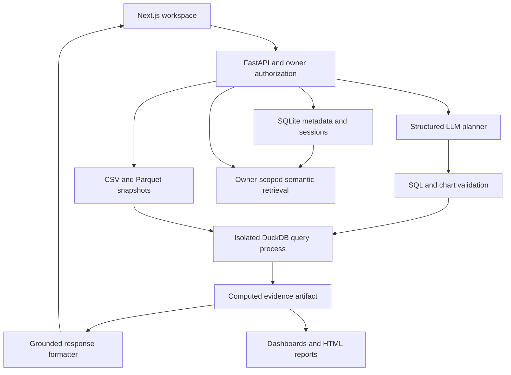

# Technical Requirements Document

## 1. Status and decisions
This document defines the full implementation target. Phase 0 provides the application foundation; Phase 1 adds authentication, owner-scoped datasets, bounded CSV intake, profiles, and Parquet snapshots. Analytical capabilities remain unimplemented. See `docs/PHASES.md` and `docs/VERIFICATION.md` for actual status and unverified gates.

Readiness requires the metadata database, current schema, and writable data directory. It does not require provider credentials or an embedding model. The broader capability checks below are future targets. The same-origin proxy exposes health, authentication, and dataset routes with origin/CSRF and cookie handling. Compose adds a one-shot migration service before the API. Phase 1 adds Argon2id, multipart, and Parquet dependencies.

| Area | Decision | Reason |
| --- | --- | --- |
| Frontend | Next.js, TypeScript, Tailwind, Plotly.js | Familiar UI stack; chart specs can be validated and rendered consistently |
| Backend | FastAPI, Pydantic, SQLAlchemy, Alembic | Typed API boundaries and straightforward service separation |
| Application state | SQLite, migrations, persistent Docker volume | Minimal infrastructure for a local assignment; single API process |
| Analytics | DuckDB over immutable normalized Parquet snapshots | SQL analytics on uploaded files without external database setup |
| LLM | Gemini through a provider interface, configurable model | Structured analytical planning and grounded summaries; credentials remain server-side |
| Semantic search | Local sentence-transformer embeddings, cosine similarity | Real semantic retrieval without another service; pin model/revision before release |
| Cache | Bounded process-local TTL cache | Small deployment; cache loss on restart is acceptable |
| Exports | Self-contained HTML with embedded Plotly runtime | Offline charts and evidence without PDF/browser infrastructure |
| Deployment | Docker Compose: frontend + backend, persistent backend volume | Reproducible local evaluation |

Choose and lock compatible dependency versions during setup. Verify provider structured-output support and SDK behavior against official documentation at implementation time. Do not assume a particular model name remains available. Download the embedding model during setup/build or document first-run download; search readiness must not be falsely reported before it is available.

## 2. Architecture

Backend owns calculations, authorization, execution, and report generation. Frontend renders typed artifacts; it does not execute generated code or independently calculate displayed business totals. Use a modular monolith and one API process initially; no durable queue or continuous worker.

## 3. Data model
All IDs are server-generated UUIDs, timestamps UTC, and owner IDs derived from the authenticated session rather than request input.

| Entity | Essential fields |
| --- | --- |
| User | id, normalized email (unique), password_hash, created_at |
| Session | id, user_id, token_digest, expires_at, revoked_at |
| Dataset | id, owner_id, display_name, content_hash, version, status, original_path, parquet_path, schema_json, profile_json, row_count, created_at |
| Conversation | id, owner_id, title, selected_dataset_versions_json, created_at, updated_at |
| Message | id, conversation_id, role, content, status, created_at |
| Analysis | id, owner_id, conversation_id, question, plan_json, sql, dataset_versions_json, result_json, chart_specs_json, method_json, status, timings_json, created_at |
| Dashboard | id, owner_id, title, dataset_versions_json, cards_json, created_at |
| SearchDocument | id, owner_id, analysis_id, embedding_model_revision, embedding_blob, searchable_text |

Upload is immutable: a replacement creates a new dataset ID/version. Store file locations internally; never return filesystem paths. Analysis evidence contains bounded result rows and aggregate metadata, not an unrestricted raw data copy. Foreign keys and indexes enforce relationships; application services enforce owner scopes. Enable SQLite foreign keys and use WAL with short transactions. Do not run multiple API replicas against this initial design.

Deletion removes files and associated cache/embedding entries. Delete or invalidate dependent analyses and dashboard cards so deleted data cannot be exposed through a saved artifact. Return a clear unavailable-source state. Exports are generated on demand; avoid persistent report copies. State the cascade behavior in the README.

## 4. CSV ingestion
1. Authenticate and enforce upload/concurrency limits before accepting work.
2. Stream to a randomly named temporary file while counting bytes; do not trust Content-Length or file extension.
3. Parse UTF-8/BOM CSV with bounded rows/columns. Reject empty headers, duplicate headers, malformed rows, invalid encoding, zero-data files, and exceeded limits. Reject NUL/control characters in headers; retain a safe display-name mapping.
4. Normalize table/column identifiers to server-controlled names; preserve original labels for display. Do not interpolate user headers into SQL.
5. Infer types conservatively. Ambiguous dates remain strings until confirmed; preserve leading-zero identifiers. Document numeric null/invalid-value behavior and timezone assumptions.
6. Produce profile statistics and a normalized Parquet snapshot. Record SHA-256 and schema/version. Use atomic file moves and a short metadata transaction; clean up failures.
7. Return per-file accepted/rejected results. File parsing runs off the request event loop and has a deadline.

Limits: 10 MiB/file, 100,000 rows/file, 50 columns/file, five selected datasets, 500 result rows, six cards/dashboard. Rate-limit costly operations and cap concurrent query processes at two by default. Store files outside web-served directories.

## 5. Analytical request pipeline
1. Authorize conversation and selected dataset IDs. Resolve their immutable versions and schemas.
2. Build bounded context from recent messages, prior structured intent, profile statistics, and relevant schema descriptions. Raw sample cells are excluded by default; any optional sample disclosure must be explicitly documented and redacted.
3. Request an `AnalysisPlan`: action (`query`, `anomalies`, `dashboard`, `clarify`), selected dataset IDs, SQL where applicable, join assumptions, chart intent, and concise user-facing method.
4. Validate every field. Unknown datasets, invented columns, unconfirmed joins, unsupported actions, or ambiguous definitions become clarification/errors.
5. Validate SQL and execute in a resource-limited child process, or invoke deterministic anomaly/dashboard tools. Never execute arbitrary generated Python.
6. Save evidence: dataset versions, validated SQL, bounded rows, result schema, count/truncation metadata, deterministic chart specs, and method facts.
7. Ask the model for a concise narrative using only bounded evidence. Verify referenced metric IDs/values against evidence; assemble numeric displays server-side. If validation fails, return the computed table and a deterministic method explanation instead of an unsupported narrative.
8. Persist completed analysis and its search document. Failed analyses remain visible with safe errors but are not indexed as successful evidence.

Provider calls have finite timeouts and at most one repair attempt for invalid structured output. Do not repeatedly regenerate SQL after semantic validation failures; ask for clarification when needed. Keep total request budgets explicit: proposed 30-second provider call, 5-second query, 60-second analysis deadline, configurable and measured.

## 6. SQL execution boundary
Parse exactly one statement with a SQL AST parser compatible with DuckDB. Permit SELECT/CTE queries only. Recursively validate CTEs, subqueries, table references, columns, and all function calls against an allowlist. A keyword regex is insufficient.

Reject DDL/DML, COPY, ATTACH, PRAGMA, INSTALL/LOAD, external scans, table-valued/file/network functions, system catalogs, unregistered tables, dynamic SQL, and unsupported constructs. Allow a small documented set of aggregates, arithmetic, date operations, CASE, grouping, ordering, and controlled joins. Disallow recursive CTEs initially.

The parent creates a per-request DuckDB database containing only authorized snapshot tables. The execution child opens it read-only with external access and extension auto-install/load disabled and locked configuration where supported. The child has no provider credentials, no shell access, no outbound network, restricted filesystem visibility, memory/CPU limits, and a hard parent-enforced deadline. AST restrictions and engine configuration supplement process isolation; neither alone is a complete sandbox.

Impose result caps outside the generated query, preserve aggregate semantics, and mark truncation. Limit threads and DuckDB memory. Bound intermediate work through process limits. On timeout/cancellation terminate and reap the child, delete temporary databases, and release concurrency permits in `finally`. Verify these controls in the Linux Docker runtime; document limitations of any unsupported local platform.

Joins require selected datasets and explicit confirmed keys. Profile key uniqueness, nulls, unmatched keys, and potential many-to-many multiplication. Do not silently sum duplicated revenue after a join. Reject an unsafe or ambiguous join pending user clarification.

## 7. Charts, anomalies, dashboards
**Charts:** backend creates a validated `ChartSpec` with type, title, x/y keys, labels, units, series, and analysis ID. No generated JavaScript/HTML. A line chart needs an ordered temporal/numeric x-axis; scatter needs numeric axes; pie needs nonnegative values with positive total and a small category count. Aggregate into “Other” only with disclosed logic. Render Plotly from computed values.

**Anomalies:** initial method is deterministic IQR outliers on a selected numeric measure, optionally by a confirmed group. Use Q1/Q3 and 1.5×IQR bounds, exclude nulls with disclosed counts, require at least 20 valid observations per group, and return no IQR verdict when IQR=0. Include original row reference, value, bounds, group, sample size, and rule version. These are statistical flags, not proof of fraud or error. Time-series deviations may be added only as a separate documented method.

**Dashboards:** planner suggests up to six cards using valid schema fields; each card passes the same query validator/executor. A fixed grid is sufficient. Record per-card evidence and failures; show partial results honestly. Limit dashboard concurrency and total deadline separately. Saved cards reuse persisted artifacts and display source versions.

## 8. Conversation, semantic search, caching
Context stores structured analytical intent as well as messages. Follow-ups reuse filters/groupings only when applicable to the same dataset versions. On selected-data changes, revalidate context and ask for clarification when necessary. Bound recent messages and summarize older context without treating model summaries as computed evidence.

Semantic search indexes question + grounded summary + column/dataset descriptors of successful analyses. Use local embeddings with a pinned model/revision and normalized vectors. Query only the current owner's eligible analyses before ranking by cosine similarity; top-k defaults to five, maximum ten. Delete embeddings on source deletion. Search results are navigational references, not newly computed answers. Missing embedding runtime returns `SEARCH_UNAVAILABLE`, not a fake semantic result or an unlabeled keyword fallback.

Cache only deterministic successful execution artifacts after validation. Key: owner ID, sorted dataset IDs/versions/hashes, canonical SQL AST or canonical tool parameters, validator version, and tool/rule version. Chart formatting can have its own versioned key. Do not use question-text similarity as a numeric result cache. Proposed TTL 15 minutes, at most 128 entries and 64 MiB total; refuse oversized entries. Never cache errors, auth state, or unrestricted narrative responses. Reauthorize on every cache hit and expose `cache_hit` in metadata. Deletion evicts dependent entries.

## 9. Authentication and security
Use Argon2id password hashing and opaque random server sessions. Store token digests only; session lifetime defaults to 24 hours. Cookies are HttpOnly, SameSite=Lax, Secure under HTTPS. Use a same-origin frontend proxy for `/api`; state-changing requests require origin validation and a CSRF token. Local HTTP cookie settings must be explicit development configuration. Logout revokes the server session. Return generic login failures and rate-limit login attempts.

Owner-check every resource query, including nested message/analysis/card reads, search, download, deletion, and cached artifacts. Foreign-resource reads return a consistent not-found response. Escape user content in UI and HTML exports. No client-controlled paths, remote image URLs, generated executable HTML, or formula interpretation of CSV values. Keep provider keys server-only. Clearly state that schema/profile metadata is sent to the configured LLM and describe data retention.

## 10. Proposed API contracts
Prefix `/api/v1`; publish typed OpenAPI schemas. These are implementation targets.

| Method / path | Behavior |
| --- | --- |
| POST `/auth/register`, `/auth/login`, `/auth/logout` | Local account/session lifecycle |
| GET `/auth/me` | Current user |
| POST `/datasets` | Multipart uploads; per-file status and validation errors |
| GET `/datasets`, `/datasets/{id}` | Owner-scoped listing/profile |
| DELETE `/datasets/{id}` | Remove dataset and invalidate dependencies |
| POST `/conversations` | Create with selected dataset IDs |
| GET `/conversations/{id}` | Messages and bounded artifacts |
| PATCH `/conversations/{id}` | Update selected dataset IDs with context revalidation |
| POST `/conversations/{id}/messages` | Analyze or clarify a natural-language request |
| GET `/analyses/{id}` | Completed evidence or safe failure status |
| POST `/dashboards`, GET `/dashboards/{id}` | Generate/save and reopen dashboard |
| POST `/search` | Owner-scoped semantic query |
| POST `/reports/export` | Authorized analysis/dashboard IDs → HTML attachment |
| GET `/health/live`, `/health/ready` | Process and local dependency readiness |

Response envelope: `request_id`, `data`, optional `meta`. Error envelope: `request_id`, `error: {code, message, details}`; details must be sanitized. Status codes: 400/422 invalid input, 401 unauthenticated, 404 inaccessible resource, 413 upload too large, 429 limit reached, 502 provider failure, 504 timeout, 503 unavailable dependency. Never return internal paths or stack traces.

Analysis artifact fields: `id`, `status`, `answer`, `method`, `assumptions`, `dataset_versions`, `sql`, `table: {columns, rows, returned_rows, truncated}`, `charts`, `anomalies`, and `meta: {cache_hit, timings_ms}`. A clarification contains a user-facing question and no fabricated executed result.

## 11. Reports and observability
Generate an HTML attachment from authorized saved evidence with escaped text, embedded chart data/runtime, styled tables, query/method details, source versions, and UTC generation time. Limit report size and selected artifact count. HTML export is the committed bonus format; PDF export is optional future work. Test an exported file offline.

JSON logs include request ID, route, status, duration, owner pseudonymous ID, operation, dataset count, provider/model, token counts when available, cache state, validator rejection code, and execution outcome. Exclude raw data, passwords, cookies, prompts, queries containing literals, and result rows. Redact exception messages. Track upload/analysis/query/provider durations, query timeouts, cache hits/misses, and failures in bounded counters or a lightweight metrics endpoint. Never use user IDs or dataset names as metrics labels. Readiness checks metadata/filesystem/model availability; provider configuration is reported without making a paid request per probe.

## 12. Testing and evaluation
Use synthetic sales/products/customer CSVs with documented date, quantity, price, revenue, and join semantics. Check in independently calculated expected answers and a deliberately anomalous fixture.

| Layer | Required coverage |
| --- | --- |
| Unit | CSV encoding/header/limit cases; SQL AST allow/deny; chart validity; IQR small/constant/null data; canonical cache keys; owner-scoped search ranking |
| Integration | Upload→query→chart→follow-up; multiple-file join; auth/logout and cross-owner denial; export; dashboard partial failures; deletion invalidation; provider malformed/failure responses |
| Execution safety | File/network scans, nested forbidden SQL, multiple statements, oversized query, timeout and cancellation cleanup, concurrency permit recovery |
| Evaluation | Known region revenue, monthly sales, top customers, defined underperformance, anomalies, clarification, prompt injection, schema hallucination |
| Delivery | Frontend typecheck/build; offline export; Docker clean start and restart persistence; screenshots and 10–30 second demo |

Inject provider fakes only in tests; live smoke tests require credentials and are reported separately. Score numeric correctness, schema-valid plans, supported charts, source-grounded explanations, and safe refusal independently. Require all deterministic sample answers and security checks to pass. Record actual measured timings and provider/model used; do not invent benchmark claims.

## 13. Implementation sequence and release gate
1. Scaffold and lock dependencies; migrations, auth, sample fixtures, Compose, typed client.
2. Upload/profiles and immutable snapshots; owner-scoped reads and failures.
3. Structured plans, SQL policy, isolated execution, evidence artifacts.
4. Chat UI, context, charts, summaries, anomalies, joins; verify core.
5. Dashboard/report/search/cache/logs; verify all six bonuses.
6. Evaluation/security checks, clean setup, README/diagram/screenshots/video.

Expected verification commands once scaffolded: `pytest`, backend lint/type checks as configured, frontend `npm run lint` (if defined), `npm run typecheck`, `npm run build`, and `docker compose up --build`. Do not describe these as having passed before running them.

Release requires passing PRD criteria, reproducible documented setup, honest limitations, no committed secrets/private data, bounded resource cleanup, and complete submission assets. This design targets a single-user-process local evaluation environment, not proven enterprise production scale.
