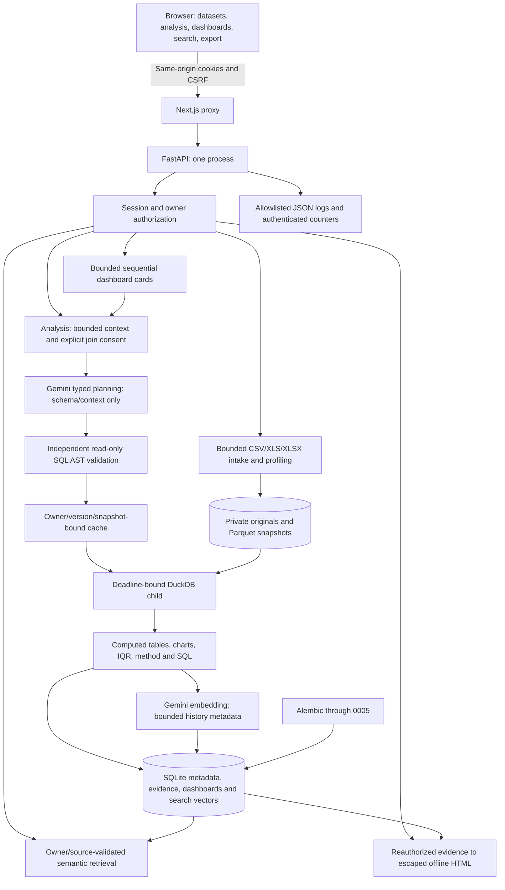

# Current architecture

Ownership and source identity are rechecked for reads, cache hits and exports. Model output and dataset text cannot authorize execution. Only registered snapshots reach DuckDB; generated Python/shell commands never execute. Charts/narratives use computed evidence. Join keys/type require explicit version-bound confirmation.

SQLite enables foreign keys, WAL and bounded busy waits. Session contexts close or roll back; provider calls occur outside long-lived application transactions. Lifespan disposes the engine. Migrations are explicit; Compose waits for migration completion and backend readiness before frontend startup.

Local storage is `backend/data`; Compose uses `backend_data`. Backend runs as UID/GID 10001 and frontend as `node`. One backend process owns concurrency, cache and counters; cache/counters reset while persisted metadata/snapshots survive restart.

Readiness checks writable storage/current schema, without provider calls or semantic-availability claims. Logs exclude arbitrary text, credentials, SQL and result rows. Credentials stay server-side.

Intake caps compressed files at 10 MiB and declared XLSX expansion at 64 MiB. Workbook parsing is not fully memory-sandboxed. DuckDB children enforce memory/thread/deadline limits; Linux adds OS CPU/address-space limits. This local runtime is not a general-purpose hostile-file/code sandbox. See [verification](../VERIFICATION.md) for actual evidence and open gates.
