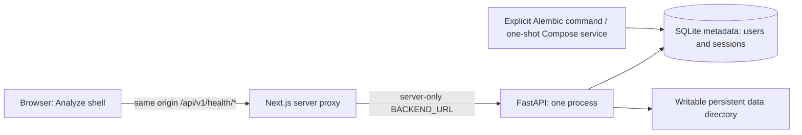

# Phase 0 architecture

Migrations finish before the Compose backend starts; frontend startup waits for backend readiness. Application containers run as non-root. The initial named volume inherits `/app/data` ownership from the backend image (UID/GID 10001). Local setup uses the current user's directory permissions.

SQLite connections enable foreign keys, WAL, and a bounded busy timeout. Request sessions close/rollback automatically; future services must explicitly commit short transactions and never hold transactions across provider calls. Engine lifetime belongs to the application lifespan. Starting the API never applies migrations.

Liveness reports process availability. Readiness probes a real file write, database query, required tables/columns, and the current migration revision. Phase 0 has no LLM or embedding dependency. Later capability checks must remain explicit.

Only health routes are exposed through the proxy. No cookies, credentials, arbitrary target URLs, or request bodies are forwarded. Authentication proxy behavior, CSRF/origin validation, uploads and bounded streaming belong to later phases.

Session storage has only a SHA-256 hex digest field, never a plaintext-token field. No session issuance or hashing flow exists yet. SQLite stores UTC timestamps without retaining timezone offsets; all future callers must write UTC and restore UTC on reads. User IDs and session IDs are generated by the ORM. No accounts are seeded.

Logs allowlist request ID (generated server-side), route template, status and duration. Unknown paths become `unmatched`; query strings, raw paths, cookies, bodies, exception strings and user data are excluded. Uvicorn access logs are disabled by the documented runner.
